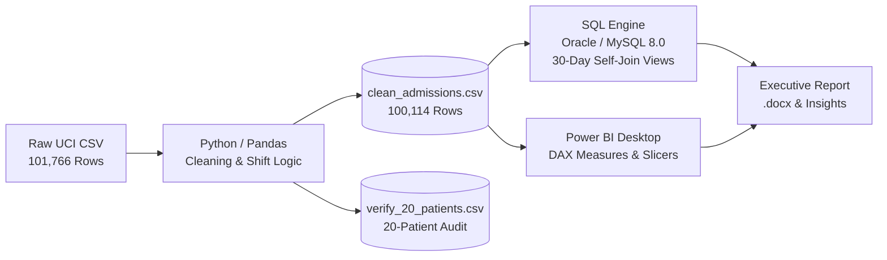

# 30-Day Clinical Readmission Risk & Cohort Intelligence (Project #16)


**Student:** Aamani Priya  
**Roll Number:** `2025B15410260`  
**Program:** HCL Data Analyst Capstone — Project #16 (Healthcare)  
**Repository:** [AamaniPriya/HCL-DA-PROJECT-Healthcare-](https://github.com/AamaniPriya/HCL-DA-PROJECT-Healthcare-)

---

## Project Objective
Preventable hospital readmissions within 30 days of discharge represent a major clinical quality and cost challenge. This repository delivers an end-to-end analytics workflow over **101,766 inpatient encounters** (*Diabetes 130-US Hospitals, UCI/Kaggle*) that:
- Cleans raw hospital records and enforces clinical exclusion rules (**missing IDs, expired discharges, inter-facility transfers, and multi-visit chronological sequencing**).
- Independently verifies 30-day readmission flags using both **Python chronological windowing** and **SQL correlated self-joins**.
- Surfaces actionable cohort risk insights through an interactive **Power BI Desktop dashboard**.

---

## Verified Pipeline Metrics

| Clinical Audit Metric | Verified Value | Pipeline Rule / Note |
| :--- | :---: | :--- |
| **Raw Encounters Ingested** | `101,766` | Baseline `diabetic_data.csv` |
| **Expired Dispositions Excluded** | `1,652` (`1.62%`) | Removed `discharge_disposition_id IN (11, 19, 20, 21)` |
| **Clean Eligible Discharges** | `100,114` | Validated analytical denominator (`clean_admissions.csv`) |
| **Inter-Facility Transfers Isolated** | `18,081` (`18.06%`) | Flagged `is_transfer = 1` (IDs `2, 3, 4, 5`), excluded from unplanned returns |
| **30-Day Unplanned Readmissions** | `4,067` | Non-transfer return visits within `1–30` days |
| **Portfolio 30-Day Readmission Rate** | **`4.06%`** | 100% reconciled across Python, SQL, and Power BI |

---

## System Architecture & Dimensional Model



The analytical layer follows a **Star Schema** centered on `FACT_ADMISSIONS` (`encounter_id`, `patient_nbr`, `diag_id`, `admission_date`, `discharge_date`, `is_transfer`, `readmit_30d_flag`) linked to `DIM_PATIENT`, `DIM_DIAGNOSIS`, and `DIM_DATE`.

---

## Cohort Intelligence Summary

### 1. Primary Diagnosis Variance vs. Benchmark (`4.06%`)
| Primary Diagnosis | Eligible Admissions | 30-Day Readmissions | 30-Day Rate | Variance vs. Avg |
| :--- | :---: | :---: | :---: | :---: |
| **Diabetes** | 8,693 | 547 | **6.29%** | `+2.23 pp` |
| **Digestive** | 9,183 | 426 | **4.64%** | `+0.58 pp` |
| **Respiratory** | 10,091 | 457 | **4.53%** | `+0.47 pp` |
| **Circulatory** | 29,834 | 1,148 | **3.85%** | `-0.21 pp` |
| **Other** | 42,313 | 1,489 | **3.52%** | `-0.54 pp` |

### 2. Age-Stratified Risk vs. Volume
- **Highest Risk Rate:** Young adults aged **`[20-30)`** record a **`9.21%`** readmission rate (`152 / 1,650`), followed by **`[30-40)`** at **`5.92%`** and **`[40-50)`** at **`5.24%`**.
- **Highest Absolute Volume:** Seniors aged **`[70-80)`** (`942` readmissions) and **`[60-70)`** (`914` readmissions) account for **45.6%** of all 30-day readmissions.

---

## Core SQL & Power BI Logic

### Relational 30-Day Self-Join (`vw_readmission_30d`)
```sql
CREATE OR REPLACE VIEW vw_readmission_30d AS
SELECT a.encounter_id, a.patient_nbr, a.age_group, a.diagnosis_group,
       a.admission_date, a.discharge_date,
       CASE WHEN EXISTS (
           SELECT 1 FROM patient_admissions b
           WHERE b.patient_nbr = a.patient_nbr
             AND b.encounter_id <> a.encounter_id
             AND DATEDIFF(b.admission_date, a.discharge_date) BETWEEN 1 AND 30
       ) AND a.is_transfer = 0 THEN 1 ELSE 0 END AS sql_readmit_30d_flag
FROM patient_admissions a;
```

### Power BI DAX Measures
```dax
Total Admissions     = COUNT(clean_admissions[encounter_id])
30-Day Readmissions  = SUM(clean_admissions[readmit_30d_flag])
Readmission Rate %   = DIVIDE([30-Day Readmissions], [Total Admissions], 0)
```

---

## Repository Contents
```text
HCL-DA-PROJECT-Healthcare-/
├── clean_readmissions.ipynb                      # Python data cleaning, edge-case filtering & EDA
├── oracle_readmission.sql                        # Table DDL, 30-day self-join & summary views
├── readmission_dashboard.pbix                    # Interactive Power BI Desktop report
├── verify_20_patients.csv                        # 20-patient manual & SQL concordance sample
├── Aamani_Priya_Patient_Readmission_Report.docx  # Final Capstone Report
└── README.md                                     # Project overview & reproduction guide
```

---

## Quick Reproduction Steps
1. Run `clean_readmissions.ipynb` with `diabetic_data.csv` to export `clean_admissions.csv`, `verify_20_patients.csv`, and `oracle_inserts.sql`.
2. Execute `oracle_readmission.sql` in Oracle SQL or MySQL 8.0, load the insert script, and query `SELECT * FROM vw_readmission_summary;`.
3. Open `readmission_dashboard.pbix` in Power BI Desktop and refresh against `clean_admissions.csv`.
